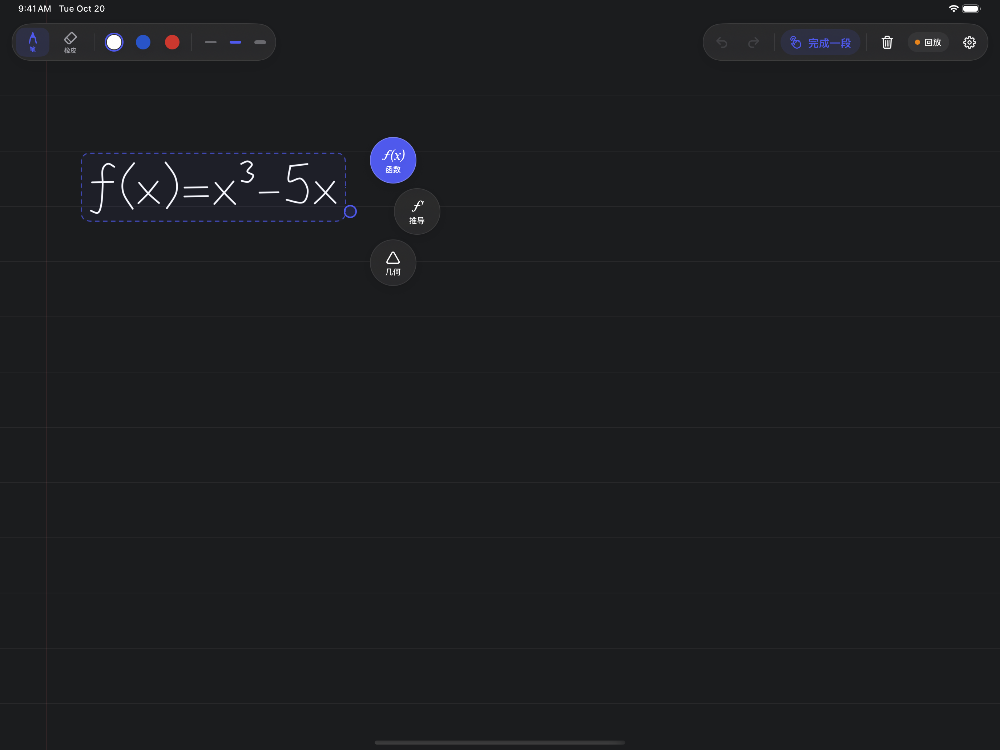
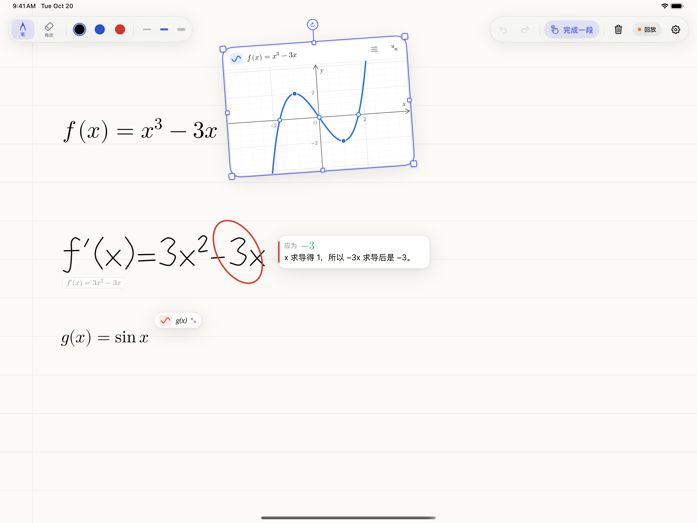
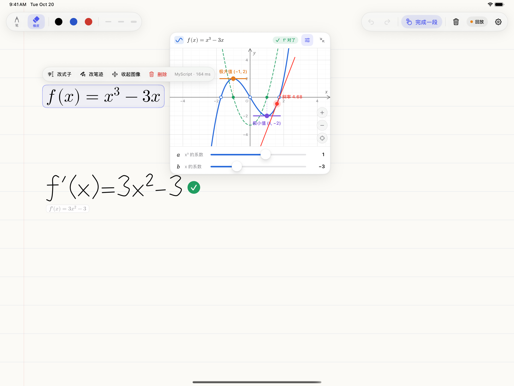
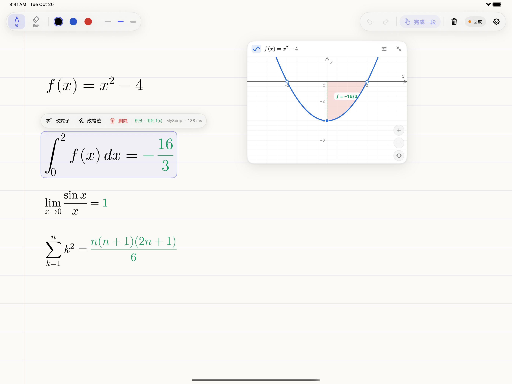
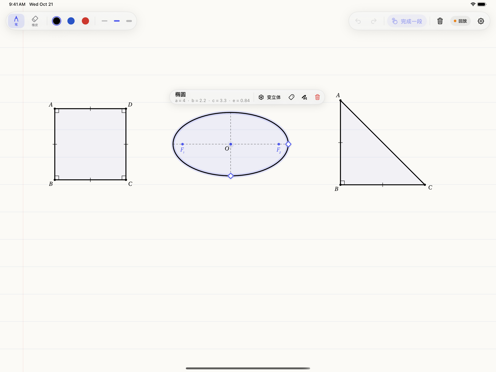
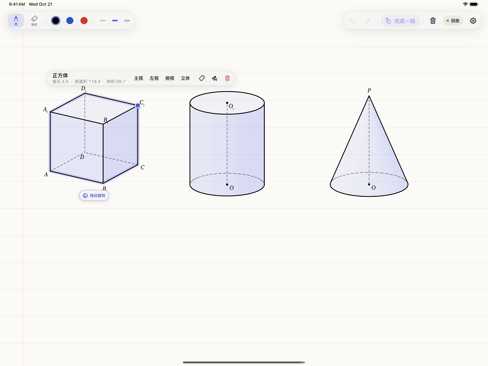

# handwriting-recognize

iPad 笔迹数学。能编译、签名、装到设备上的 Mac 只有一台，就是 RuikAn-n 的 MacBook。演示机是这台 iPad Pro，笔是 Pencil Pro。

P2、P3、P4 把源码推到自己的分支。`main` 只表示这一版已经在那台 iPad 上装过。

- 客户端计划：[docs/P1-iPad客户端开发计划.md](docs/P1-iPad客户端开发计划.md)
- 基线：[docs/笔迹AI家教-Swift原生48小时方案.md](docs/笔迹AI家教-Swift原生48小时方案.md)
- 工程：`app/InkTutor.xcodeproj`

`MyCertificate.c` 不进这个仓库。真机三项验证还没做，结果写在 [docs/device.md](docs/device.md)。

## 这一版怎么用（p1/redesign）

整屏一张纸，顶上只有笔的状态和功能键（笔 / 橡皮、颜色、粗细、撤销、重做、完成一段、清空、识别引擎、设置）。不再有模式按钮，也没有常驻的右半屏。

- **多份草稿**（参考无边记）：打开 App 先看到草稿画廊（缩略图、名字、修改时间），可以新建、搜索、排序，长按重命名、复制、删除。每份草稿自动存在 iPad 上（打开时每 3 秒有变化就存，离开、切到后台时也存），重新打开按 LaTeX 重建式子、导数、求解，并滚回上次的位置。草稿里左上角回画廊，点名字改名。
- **纸可以上下滚**：没开手指书写时一根手指拖，开了是两根手指；写到靠近底下自动接长。式子、卡片、图形跟着笔迹一起滚。
- **函数卡片右上角的小眼睛**：只留函数图像和坐标轴，参数滑条、切线、导函数、零点极值、积分面积和式子都收起来。
- **窗口化**（台前调度、分屏，或者窗口很窄）：工具栏只剩右上角一枚小胶囊——笔、橡皮、清空、设置；设置键里有草稿列表、重命名、撤销、重做、完成一段、颜色和粗细。笔尖旁的菜单、新卡片、操作条也都缩小。

1. 先只显示原始墨迹。写完一段，**双击 Pencil Pro**，表示这一段输入完了；笔尖旁弹出「函数 / 求解 / 几何」。双击没进回调（或在模拟器上）时点工具栏的「完成一段」。
2. 选 **函数**：用 MyScript iink 的 Math Recognizer 把这段笔迹收成 LaTeX，手写笔迹淡出，换成标准式子。
3. 式子右上角挂一张 GeoGebra 式的函数卡片：网格、坐标轴、零点和极值点，拖动平移、双指缩放、双击复位，Pencil 悬停读坐标。
   点卡片标题栏选中后像 PS 的自由变换一样：拖四角 / 四边改大小，拖上方圆钮旋转（靠近整 90° 吸附），双指捏合缩放、转动。右上角的按钮收起成一枚小胶囊（minimize），点胶囊展开。
4. 点式子出操作条：改式子（手动改 LaTeX）、改笔迹（把原来的笔迹放回画布，擦改完双击、选「函数」更新这一条，卡片位置不变）、收起 / 展开图像、删除。拖动式子，卡片一起走。
5. **求解**（原来的「求导」并进来了）：写下要算的东西，双击选「求解」，App 直接算出结果，换成标准式子，算出来的部分是绿的。选「函数」时写的其实是要算的东西，也会转过来。
   - 求导：在函数下面写 `f'(x)`（`f''(x)`、`y'`、`f'(2)` 也行），例如 `f(x)=x^2-4` 下面得到 `f'(x)=2x`，原函数的卡片里画出导函数（绿色虚线）、极值点和水平切线；也可以写 `\frac{d}{dx}(x^2\sin x)`。
   - 积分：`\int x e^x dx = xe^{x} - e^{x} + C`、`\int_0^1 x^2 dx = \frac{1}{3}`、`\int_0^\infty e^{-x}dx = 1`；对写过的函数 `\int_0^2 f(x)dx = -\frac{16}{3}`，f 的卡片里把这块面积涂出来（x 轴下方的部分是红色）。
   - 极限：`\lim_{x\to0}\frac{\sin x}{x} = 1`、`\lim_{x\to\infty}(1+\frac{1}{x})^x = e`、单侧 `x\to 0^+`；`\lim_{x\to3}f(x)` 在卡片里标出那一点。左右极限不等、振荡时写明「极限不存在」。
   - 求和 / 连乘：`\sum_{k=1}^{n}k^2 = \frac{n(n+1)(2n+1)}{6}`、`\sum_{n=1}^{\infty}\frac{1}{n^2} = \frac{\pi^2}{6}`、`\prod_{k=1}^{5}k = 120`；发散时写明「级数发散」。
   - 也能直接算一个完整的式子（不引用函数）、对函数取值（`f(3)`）、解方程（`x^2-4=0` ⇒ `x = \pm 2`）。
   - 能用符号方法（代入、洛必达、原函数、求和公式）就给准确值；不行再用数值方法（双指数积分、Richardson 外推），并尽量认回 π/4、e − 1、√2、分数这样的形式，认不出就写 ≈ 六位有效数字。
   - 引用的函数一改（改笔迹、改式子、拖滑条），下面的结果跟着重新算。不再批改学生自己写的导数。
6. **几何**：画一个图形，双击选「几何」，草图自动认成标准图形，就画在纸上原来的位置（不放卡片）。
   - 平面：线段、三角形（认出等边 / 等腰 / 直角，并把手抖修正成真的直角、真的等腰）、正方形、矩形、菱形、平行四边形、梯形、正多边形、圆、椭圆。接近水平的边会放平。
   - 立体：正方体 / 长方体（前后两个面加连线，或者只画看得见的 9 条棱）、圆柱（上下底 + 两条母线，下底只画半个也行）、圆锥、球（圆 + 赤道）、三棱柱、四棱锥、三棱锥（要有一条虚线）。手画的虚线会连成一条。
   - 点图形选中，出现节点：拖顶点改形状（正方形拖角仍是正方形、矩形拖边改一边、正多边形拖顶点是绕中心转 + 缩放、平行四边形 / 菱形保持性质、一般的三角形随便拖，名字跟着变成「直角三角形」「等腰三角形」……），拖上方的圆钮旋转（整 15° 吸附），拖图形本身移动；圆拖边上的点改半径，椭圆拖两个半轴端点改 a、b 和方向。
   - 课本的标注：顶点字母、直角记号、相等的边打短线、椭圆的焦点 F₁ F₂、立体图形的 ABCD-A₁B₁C₁D₁、O、O₁；看不见的棱画虚线。信息条实时写出边长、角度、周长、面积，椭圆的 a、b、c、e，立体的表面积、体积。
   - 立体图形：拖方块节点改棱长 / 半径 / 高，拖下方的「拖动旋转」转视角，信息条上一键主视 / 左视 / 俯视（三视图）/ 立体。平面图形可以「变立体」：正方形 → 正方体、四棱锥，矩形 → 长方体，圆 → 圆柱、圆锥、球，三角形 → 三棱柱、三棱锥。
   - 三角形加中线的草图沿用 P3 的动态几何卡片（中点、重心跟着拖）。

识别链：MyScript（设备上）→ 百炼 → Mac 上的 Server；都没有就回放，前两幕不靠网络。设置里可以指定引擎。

界面（CI 在 iPad 模拟器上用 `-demo` 摆出来截的，见 `docs/screenshots/`；每次带 `[mac]` 的构建都会重截一套浅色 + 深色，在 Actions 的 `screenshots` 里下载）：

| 双击后笔尖旁的菜单 | 标准式子 + 函数卡片（选中，可变换） | 求导：写 f′(x) 直接求出 2x，卡片里画出导函数 |
| --- | --- | --- |
|  |  |  |

| 求解：∫₀² f(x)dx（卡片里涂出面积）、lim、∑ |
| --- |
|  |

| 几何：手画的正方形、椭圆、直角三角形（选中椭圆：焦点、节点、a b c e） | 几何：手画的正方体、圆柱、圆锥（选中正方体：尺寸节点、拖动旋转、三视图） |
| --- | --- |
|  |  |

## MyScript iink

- SDK：Swift 包 [MyScript/interactive-ink-packages-ios](https://github.com/MyScript/interactive-ink-packages-ios) 4.5.1，工程里已经加好（product `libiink`）。
- 证书：MyScript 开发者后台发的 `MyCertificate.c` 复制到 `app/InkTutor/MyScriptCertificate/MyCertificate.c`。这个目录在 `.gitignore` 里，Xcode 的文件夹同步会把它编进 App。没放证书也能编译运行（`MyScript/CertificateFallback.c` 是空证书的弱定义），函数识别退回其他引擎，设置页写明缺什么。
- 数学识别资源（math2，约 14 MB）不进仓库：Mac 上第一次编译时「MyScript Recognition Assets」这一步自动下载到 `app/MyScript/`，也可以手动跑 `tools/myscript/fetch-assets.sh`。这份资源是 MyScript 给示例程序用的。
- Bundle ID 要和证书对得上，否则设置页显示「证书无效」。
- **证书在授权后台要启用**：license.myscript.com › Applications › InkTutor，证书 `dev.handwriting.inktutor` 那一行的 Enabled 开关是绿的才行（2026-10-20 我们这张建好后是关着的；关着时 iink 只报 "invalid certificate"，和 Bundle ID 对不上时一样）。
- 识别在设备上做，但 iink 每次启动会联网到 license.myscript.com 查一次授权：演示现场要有网。没网时 iink 会怎样还没实测，App 的识别链会退回百炼 / Server / 回放。

模拟器编译由 CI 验证（`ios-build`，commit 信息带 `[mac]` 或手动触发）。真机上的 Pencil 双击、悬停落点、整笔擦除、MyScript 实际识别效果还要在那台 iPad 上看，结果写进 [docs/device.md](docs/device.md)。函数、求导已经在 iPad 上实测过；「求解」（极限、积分、求和）只在模拟器上编译、截图过，还没装到 iPad 上。
